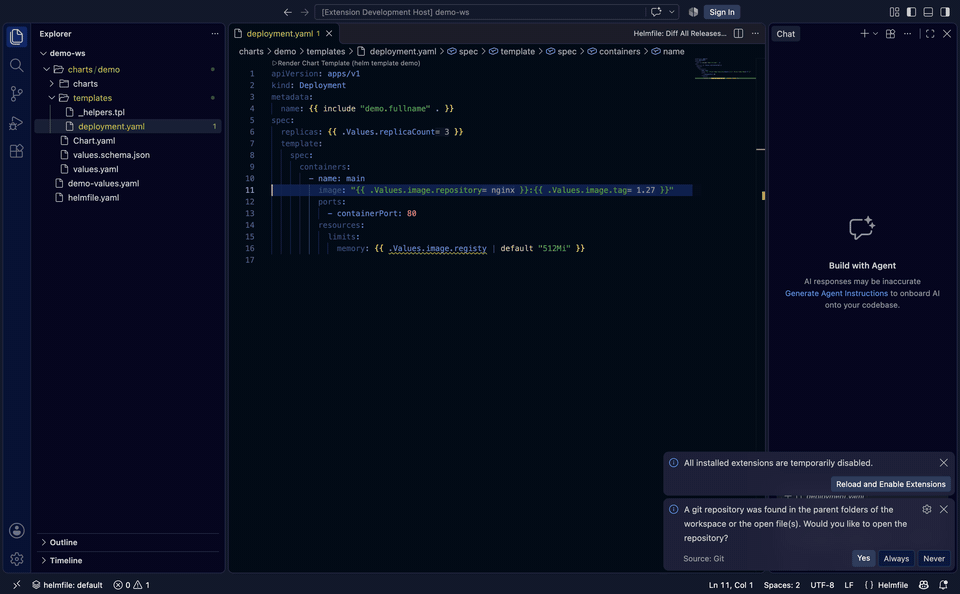

# Helmfile for Visual Studio Code

English | [简体中文](README.zh-CN.md)

**Helmfile for Visual Studio Code** turns `helmfile.yaml` and the Helm
charts it deploys into first-class code: schema-aware completion and
validation, Go template intelligence (diagnostics, hover docs,
highlighting), jump-to-source for values — including the *effective*
values resolved from chart defaults, overlay files and `set:` entries —
and one-click `template` / `diff` / `apply` / `destroy` per release.
Everything works statically, no cluster required.

At a glance:

- **helmfile.yaml** — field / chart / repository / values / environment
  completion, unknown-field & missing-file validation, environment
  switching
- **Helm charts** — effective-values completion, `values.schema.json`
  checking, `$var` & `range` awareness, `include`/`define` navigation,
  `helm template` lens
- **Operations** — per-release `template` / `diff` / `apply` / `destroy`
  with diff review, all static, no cluster needed

Originally ported from the
[helmfile-intellij-plugin](https://github.com/k3rnL/helmfile-intellij-plugin)
with feature parity.



## Installation

### From a prebuilt VSIX

Download the latest `vscode-helmfile-<version>.vsix` from
[Releases](https://github.com/helmfile/vscode-helmfile/releases), then:

```bash
code --install-extension vscode-helmfile-0.3.0.vsix --force
```

`--force` upgrades an already-installed older version. Reload the window
afterwards (**Developer: Reload Window**). On Remote-SSH / devcontainer
setups, use **Extensions: Install from VSIX…** on the remote side instead.

### Build from source

```bash
git clone https://github.com/helmfile/vscode-helmfile.git
cd vscode-helmfile
npm install
npm run package   # produces vscode-helmfile-<version>.vsix
code --install-extension vscode-helmfile-<version>.vsix --force
```

### Try without installing

Open the repository in VSCode and press **F5** — an Extension Development
Host launches with the sample state in `examples/`.

## Features

### Editing

- **Go template awareness** in `helmfile.yaml` / `helmfile.yml` /
  `*.gotmpl` / `_*.tpl`: custom grammar with functions, keywords, paths,
  strings and comments; typing `{{` auto-closes with `}}`.
- **Field completion** for every Helmfile mapping (`releases`,
  `repositories`, `environments`, `helmDefaults`, …) with types and
  descriptions.
- **Block completion**: type `releases`, `repositories` or `dependencies`
  (or `- release`, `- repository`, `- dependency`) and complete to a
  Tab-navigable snippet.
- **Repository completion**: `chart:` offers declared repository aliases,
  `repository/chart` offers chart names from the downloaded Helm index,
  `version:` offers the chart's versions (newest first). OCI registries use
  tag listings.
- **State values completion**: `.Values.`, `.StateValues.`,
  `.Environment.Values.` paths complete from the resolved values model
  (`values:` entries, `bases:` inheritance, environment overrides, glob
  paths, `{{ .Environment.Name }}` in paths).
- **Context-aware completion**: the editor knows what each field means —
  `needs:` offers the release names of this state, `inherit:` offers
  template declarations, `condition:` offers `<release>.enabled` and
  `.Values.<key>.enabled` flags, `kubeContext:` lists contexts from
  `$KUBECONFIG` / `~/.kube/config`, `values:` / `secrets:` / `bases:` /
  `helmfiles:` / `path:` offer files next to the state, `chart: ./…`
  offers local chart directories. Field completion hides keys already
  present in the mapping and ranks frequently-used fields first.
- **Chart-aware values completion**: keys in a release's values files
  (`values/*.yaml.gotmpl`) complete from the chart's own `values.yaml`
  defaults — local charts read from disk, remote charts from the download
  cache — and `set:` / `setString:` name entries offer dotted key paths
  (`image.tag`) with each key's chart default as the detail.
- **Environment variable completion**: inside `{{ env "…" }}` and
  `{{ requiredEnv "…" }}` quotes, variables come from the extension
  host environment and `.env` / `.env.local` files at the workspace root
  (project-local entries first, values shown in the detail).

### Navigation

- Go to definition / find usages for values paths, including
  `{{ index .Values "quoted.key" }}` forms.
- `repository/chart` prefix → repository declaration; repository name →
  chart usages.
- Chart name segment → **downloads the chart** (`helm pull`) and opens
  `Chart.yaml`; downloaded charts appear in the *Chart Sources* explorer
  view and are restored from cache on reload.
- `readFile` / values file / base file / nested state arguments open the
  target file.
- Template inheritance: `inherit: [{template: parent}]` ↔ template
  declarations (definition + usages).

### Documentation (hover)

- Go template / Sprig / Helmfile function documentation with signature,
  example and reference link.
- Values paths show the resolved value, its source file and environment —
  including quoted keys via `index .Values "a.b"` and `get` in both forms
  (`.Values | get "a.b" false` / `get .Values "a.b" false`).
- Inside any template action, other expressions (`if`/`range` conditions,
  `readFile … | fromYaml` chains, `get` defaults for keys no values file
  defines) show their statically computed value with its provenance.
- States with template-generated `environments:` entries (e.g. a `{{ range }}`
  over `readFile … | fromYaml`) resolve each environment's `values:` files
  after rendering the region, so values, completions and navigation work
  there too.

### VSCode integration

- **Semantic highlighting** for template actions: keywords, Go / Sprig /
  Helmfile functions, value paths, variables, strings, comments and
  numbers (on top of the TextMate grammar).
- **Outline & breadcrumbs**: releases, repositories, environments (with
  values files) and templates in the document symbol tree.
- **Folding** for YAML blocks and `---` documents.
- **Smart selection** (expand selection): identifier → dotted path →
  `{{ action }}` → YAML pair → mapping → document.
- **Quick fixes**: delete empty `{{}}` actions, close unclosed actions,
  remove orphan `}}`, refresh chart repositories from the warning.
- **Status bar** shows the active environment; click to switch.
- Diagnostics re-run debounced (150 ms) while typing.

### Environments

- Code lens on each `environments:` entry switches the active environment
  (check mark on the current one); also **Helmfile: Select Environment**.
  Selection is persisted **per helmfile project** and drives completion,
  navigation and chart version resolution.
- **Template-generated environments** are recognized statically — nothing is
  executed. States that generate entries with Go templates (the common
  workaround for [roboll/helmfile#1045](https://github.com/roboll/helmfile/issues/1045))
  resolve through two tiers:
  1. the pure read-only chain `readFile` → `fromYaml` → `index` over
     template variables — the keys of the resulting mapping become
     environment names (e.g. `bases/environments.yaml`);
  2. directory inference from value paths like
     `environments/{{ $key }}/*.yaml.gotmpl` — one environment per child
     directory.

  Inferred names appear in the environment switcher (a lens on the
  `environments:` key marks them *inferred*) and behave like literal ones
  everywhere else.

### Project detection

- Helmfile projects are recognized the way the `helmfile` CLI resolves
  them: `helmfile.yaml` → `helmfile.yaml.gotmpl` → `helmfile.d/*.{yaml,yml,
yaml.gotmpl,yml.gotmpl}` (sorted). Layouts the CLI would refuse to run
  (both `helmfile.yaml` and `helmfile.yaml.gotmpl`, or a default file next
  to `helmfile.d/`) are flagged with a warning.
- The extension activates automatically in workspaces containing a helmfile
  entry, even before any state file is opened.
- Run commands invoked outside a state file fall back to the governing
  project's entry (edit a values file, run **Helmfile: Template Release…**
  and it targets the state that would consume it).
- The status bar tooltip names the active project's entry state(s).

### Run

- Code lens on each release name: **Template / Diff / Apply / Destroy**.
- Editor context menu → *Helmfile Release Actions*; **Helmfile: Diff All
  Releases…** diffs the whole state.
- Dialog with environment picker, release/namespace inputs and a command
  preview; protected environments (regex, default `prod.*`) require
  explicit confirmation.
- **Template** renders into a read-only viewer: *All manifests.yaml* plus
  individual `<namespace>/<Kind>/<name>.yaml` resources.
- **Apply** reviews the diff first and continues through *Apply reviewed
  changes* (blocked if the state file changed meanwhile).
- **Diff** opens the native VSCode diff view per resource (added / modified
  / deleted).

### Validation

- Repository diagnostics: missing names/URLs, duplicate aliases, undeclared
  `chart:` prefixes, charts missing from the index, unavailable exact
  versions, and an outdated-version hint (with a one-click update to the
  newest cached version) when a pinned release version is behind the index.
- Unknown-field warnings for mappings the Helmfile schema fully describes
  (`releases`, `repositories`, `dependencies`, …) with a quick fix that
  removes the whole entry — catches typos like `insatlled:` before helmfile
  strict-decodes them at run time.
- Missing-file warnings when a `values:` / `secrets:` / `bases:` /
  `helmfiles:` entry points at a file that does not exist, with a quick fix
  that creates it (parent directories included).
- Unclosed / empty / orphan Go template delimiters and unmatched
  `if` / `range` / `with` / `define` / `block` blocks, plus YAML syntax
  errors — each with quick fixes.

### Chart directories

Workspaces that keep Helm charts next to their helmfile state get
chart-aware assistance inside `<chart>/templates/` files
(`*.yaml`, `*.yml`, `*.tpl`, `NOTES.txt`, including subdirectories):

- Chart template files are claimed by the Helmfile language, so YAML
  validators no longer flag Go template actions (`{{ .Values.x }}`) as
  invalid YAML, and template/YAML highlighting works everywhere.
- Diagnostics switch to Helm template rules — unclosed actions, malformed
  `{{ define }}`/`{{ range }}` blocks, YAML syntax — while Helmfile state
  checks (repositories, unknown fields, missing files) stay silent.
- Completion offers Helm's built-in variables (`.Chart.Name`,
  `.Release.Namespace`, `.Capabilities.KubeVersion`, `.Files.Get`, …),
  subchart names from `charts/`, and `.Values` keys resolved against the
  chart's **effective values**: the chart's own `values.yaml`, overlaid
  with the values files, inline `values:` mappings and `set:` entries of
  every helmfile release whose `chart:` points at this directory. Each
  completion shows which source provided the value.
- `.Subcharts.<name>.Values.` completes and previews the dependency's
  **effective values**: its own `values.yaml` overlaid with the `<name>`
  key of the parent chart's `values.yaml` and of every helmfile release
  values overlay targeting the parent chart — the same precedence Helm
  applies at render time.
- `Chart.yaml` gets dependency assistance: `name:` offers unpacked
  dependencies from `charts/`, `version:` their chart version,
  `repository:` the URLs declared in the helmfile state's `repositories:`,
  and `condition:` the `<dependency>.enabled` keys from `values.yaml`.
- When the chart ships a strict `values.schema.json`
  (`additionalProperties: false`), referencing an undeclared `.Values`
  key produces a warning with a **Declare in values.schema.json** quick
  fix that inserts the missing property chain.
- `.Files.Get "…"` / `.Files.Glob "…"` complete file paths under the
  chart root, and hovering the quoted path previews the file's content
  (or, for `Glob`, the list of matching files).
- Inside `range` / `with` blocks, relative `.field` paths complete
  against the iterated value — including element keys when ranging over
  a list of objects.
- `include "…"` / `template "…"` complete named template (`define`)
  names across all files under `templates/`, and calling a name with no
  matching `define` produces a warning with a **Create define** quick
  fix that appends a skeleton to `_helpers.tpl` (creating the file when
  missing).
- Inline value hints show the effective value of `.Values` references
  right after the code, with a tooltip naming the source (`chart
  values.yaml`, overlay file, `set:` entry). Disable with
  `helmfile.chartValueHints: false`.
- The outline of a chart template file shows its YAML structure (with
  template actions masked, so `{{ .Values.x }}` never breaks key names)
  followed by `define` declarations.
- A **▶ Render Chart Template** code lens runs `helm template` on the
  chart and shows the rendered manifests in a side-by-side editor.
- Hover documents built-in variables, previews effective values (with
  the providing source and `values.schema.json` descriptions), shows the
  body of a `define` behind an `include` call, and resolves fields of
  `range` elements.
- Go-to-definition and find-references navigate between `include` /
  `template` calls and their `define` declarations; the outline shows
  `define` declarations as symbols.
- Signature help shows catalog function parameters while typing
  space-separated calls (`include "name" `), and snippet completions
  cover `range` / `with` / `if` / `include` / `define` / `block`.

Chart assistance can be switched off with `helmfile.chartSupport: false`;
YAML/template syntax checking stays on. Opening a workspace that only
contains charts (no helmfile state) also activates the extension.

A directory is treated as a chart when it (or an ancestor, up to 16 levels)
contains `Chart.yaml` / `Chart.yml`. Helmfile state files inside a chart
keep their state treatment.

### Chart repositories

- HTTP(S) repositories download `index.yaml` only; OCI repositories use
  paginated tag listings with bearer auth.
- Static credentials, `ALIAS_USERNAME` / `ALIAS_PASSWORD` environment
  credentials, `caFile`, `certFile`/`keyFile` (PKCS#8), `skipTLSVerify`,
  `passCredentials`.
- In-memory cache: successful snapshots refresh after 5 minutes, failures
  retry after 1 minute. **Helmfile: Refresh Chart Repositories** forces a
  reload. Downloads can be disabled in settings.

## Settings

| Setting | Default | Description |
| --- | --- | --- |
| `helmfile.helmfileExecutablePath` | `helmfile` | Path to the `helmfile` executable |
| `helmfile.helmExecutablePath` | `helm` | Path to `helm` (chart source browsing) |
| `helmfile.protectedEnvironments` | `prod.*` | Regex (full match) of protected environments |
| `helmfile.disableAutomaticDownloads` | `false` | Disable repository metadata downloads |
| `helmfile.chartSupport` | `true` | Chart-aware assistance inside Helm chart `templates/` files |
| `helmfile.chartValueHints` | `true` | Inline hints showing effective `.Values` in chart templates |
| `helmfile.enableMutatingCommands` | `false` | Enable the mutating commands (Apply/Destroy) and their code lenses; hidden and refused until enabled |

HTTP(S) access honors VSCode's `http.proxy` setting.

### Note for Go users

The [Go extension](https://marketplace.visualstudio.com/items?itemName=golang.go)
claims all `.gotmpl` files as pure Go templates. Canonical state files
(`helmfile.yaml.gotmpl`, `helmfile.yml.gotmpl`) are claimed by this extension
through exact filenames and are unaffected. If you use other `.gotmpl` file
names as Helmfile templates, associate them manually:

```json
"files.associations": { "**/my-helmfile.yaml.gotmpl": "helmfile" }
```

## Development

```bash
npm install
npm run compile   # tsc + esbuild
npm run package   # vsce package
```

Press F5 to launch an Extension Development Host with the sample state in
`examples/`.
