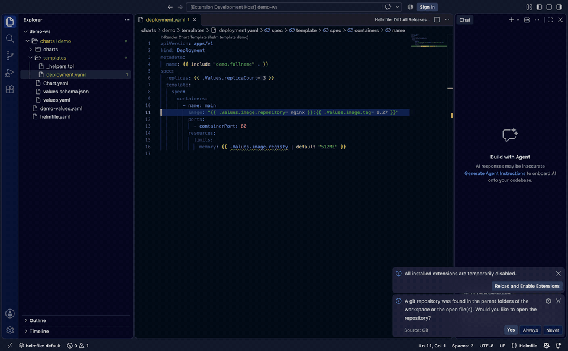

# Helmfile for Visual Studio Code

[English](README.md) | 简体中文

面向 VSCode 的 Helmfile 状态文件支持,自
[helmfile-intellij-plugin](https://github.com/k3rnL/helmfile-intellij-plugin)
移植而来,功能对齐。



## 安装

### 方式一:使用预编译 VSIX

从 [Releases](https://github.com/helmfile/vscode-helmfile/releases) 下载最新的
`vscode-helmfile-<version>.vsix`,然后执行:

```bash
code --install-extension vscode-helmfile-0.3.0.vsix --force
```

`--force` 用于覆盖升级已安装的旧版本。安装后重载窗口(**Developer: Reload
Window**)。Remote-SSH / devcontainer 场景请改在远端执行
**Extensions: Install from VSIX…**。

### 方式二:从源码构建

```bash
git clone https://github.com/helmfile/vscode-helmfile.git
cd vscode-helmfile
npm install
npm run package   # 生成 vscode-helmfile-<version>.vsix
code --install-extension vscode-helmfile-<version>.vsix --force
```

### 免安装体验

用 VSCode 打开本仓库并按 **F5**,会启动扩展开发主机(Extension Development
Host),自带 `examples/` 下的示例状态文件。

## 功能

### 编辑

- **Go 模板感知**:`helmfile.yaml` / `helmfile.yml` / `*.gotmpl` / `_*.tpl`
  上的自定义语法高亮(函数、关键字、路径、字符串、注释);输入 `{{` 自动补全
  `}}`。
- **字段补全**:所有 Helmfile 映射(`releases`、`repositories`、
  `environments`、`helmDefaults`……)的字段补全,带类型与描述。
- **块补全**:输入 `releases`、`repositories` 或 `dependencies`(或列表项
  `- release`、`- repository`、`- dependency`)补全为 Tab 逐字段跳转的代码
  片段。
- **仓库补全**:`chart:` 补全已声明的仓库别名;`repository/chart` 补全从
  Helm index 下载的 chart 名;`version:` 补全该 chart 的版本(最新优先)。
  OCI 仓库使用 tag 列表。
- **状态值补全**:`.Values.`、`.StateValues.`、`.Environment.Values.` 路径
  从解析后的 values 模型补全(`values:` 条目、`bases:` 继承、环境覆盖、
  glob 路径、路径中的 `{{ .Environment.Name }}`)。
- **上下文感知补全**:编辑器知道每个字段的含义——`needs:` 补全本状态的
  release 名;`inherit:` 补全模板声明;`condition:` 补全
  `<release>.enabled` 与 `.Values.<key>.enabled`;`kubeContext:` 列出
  `$KUBECONFIG` / `~/.kube/config` 中的上下文;`values:` / `secrets:` /
  `bases:` / `helmfiles:` / `path:` 补全状态文件旁的文件;`chart: ./…`
  补全本地 chart 目录。字段补全会隐藏映射中已有的键,并按常用程度排序。
- **Chart 感知 values 补全**:release 的 values 文件(`values/*.yaml.gotmpl`)
  中的键从 chart 自带的 `values.yaml` 默认值补全——本地 chart 读磁盘,
  远程 chart 读下载缓存;`set:` / `setString:` 的 `name:` 提供点路径
  (`image.tag`),detail 显示各键的 chart 默认值。
- **环境变量补全**:`{{ env "…" }}` / `{{ requiredEnv "…" }}` 引号内补全,
  来源为扩展宿主进程环境变量与工作区根目录的 `.env` / `.env.local`
  (项目本地条目优先,detail 显示变量值)。

### 导航

- values 路径的跳转定义 / 查找引用,含 `{{ index .Values "quoted.key" }}`
  形式。
- `repository/chart` 前缀 → 仓库声明;仓库名 → chart 引用处。
- chart 名段 → **下载 chart**(`helm pull`)并打开 `Chart.yaml`;已下载的
  chart 出现在 *Chart Sources* 资源视图中,重载后从缓存恢复。
- `readFile` / values 文件 / base 文件 / 嵌套状态文件的参数可直接打开目标
  文件。
- 模板继承:`inherit: [{template: parent}]` ↔ 模板声明(定义 + 引用)。

### 文档(Hover)

- Go 模板 / Sprig / Helmfile 函数文档,含签名、示例与参考链接。
- values 路径显示解析后的值、来源文件与环境——包括 `index .Values "a.b"`
  引号键与两种形式的 `get`(`.Values | get "a.b" false` /
  `get .Values "a.b" false`)。
- 模板动作内的其他表达式(`if`/`range` 条件、`readFile … | fromYaml` 链、
  values 文件未定义键的 `get` 默认值)会显示静态求值结果及其来源。
- 通过模板生成 `environments:` 条目的状态(例如对
  `readFile … | fromYaml` 的 `{{ range }}`),会在渲染该区域后解析每个环境
  的 `values:` 文件,values、补全与导航在这些状态下同样可用。

### VSCode 深度集成

- **语义高亮**:模板动作中的关键字、Go / Sprig / Helmfile 函数、值路径、
  变量、字符串、注释与数字(TextMate 语法之上)。
- **大纲与面包屑**:文档符号树中的 releases、repositories、environments
  (含 values 文件)与 templates。
- **折叠**:YAML 块与 `---` 多文档。
- **智能选区**(扩展选区):标识符 → 点路径 → `{{ 动作 }}` → YAML 键值对
  → 映射 → 文档。
- **快速修复**:删除空 `{{}}` 动作、闭合未闭合动作、删除孤立 `}}`、从警告
  处刷新 chart 仓库、版本一键升级、移除未知字段、创建缺失文件。
- **状态栏**显示当前环境,点击切换。
- 输入时诊断以 150ms 防抖重跑。

### 环境

- 每个 `environments:` 条目上的 CodeLens 可切换当前环境(当前项带 ✓);也可
  使用 **Helmfile: Select Environment**。选择按 **helmfile 项目**持久化,
  并驱动补全、导航与 chart 版本解析。
- **模板生成的环境**会被静态识别——不执行任何代码。用 Go 模板生成条目的
  状态(常见的 [roboll/helmfile#1045](https://github.com/roboll/helmfile/issues/1045)
  规避写法)按两层解析:
  1. 纯只读链 `readFile` → `fromYaml` → `index` 作用于模板变量——结果映射
     的键即环境名(例如 `bases/environments.yaml`);
  2. 从 `environments/{{ $key }}/*.yaml.gotmpl` 这类值路径推断目录——每个
     子目录一个环境。

  推断出的名称出现在环境切换器中(`environments:` 键上的 lens 标注
  *inferred*),并在其余各处与字面环境一致。

### 项目识别

- 按 `helmfile` CLI 的解析方式识别项目:`helmfile.yaml` →
  `helmfile.yaml.gotmpl` → `helmfile.d/*.{yaml,yml,yaml.gotmpl,yml.gotmpl}`
  (排序后)。CLI 会拒绝运行的布局(同时存在 `helmfile.yaml` 与
  `helmfile.yaml.gotmpl`,或默认文件与 `helmfile.d/` 并存)会被警告。
- 工作区包含 helmfile 入口时扩展自动激活,即使尚未打开任何状态文件。
- 在状态文件之外调用的运行命令会回退到所属项目的入口(在 values 文件中
  执行 **Helmfile: Template Release…**,目标即消费它的状态文件)。
- 状态栏提示显示当前项目的入口状态文件。

### 运行

- 每个 release 名上的 CodeLens:**Template / Diff / Apply / Destroy**。
- 编辑器右键菜单 → *Helmfile Release Actions*;**Helmfile: Diff All
  Releases…** 对整个状态做 diff。
- 对话框提供环境选择、release/namespace 输入与命令预览;受保护环境
  (正则,默认 `prod.*`)需要显式确认。
- **Template** 渲染到只读查看器:*All manifests.yaml* 及按
  `<namespace>/<Kind>/<name>.yaml` 拆分的单个资源。
- **Apply** 先审阅 diff,经 *Apply reviewed changes* 继续(期间状态文件被
  修改则阻断)。
- **Diff** 按资源打开 VSCode 原生对比视图(新增 / 修改 / 删除)。

### 校验

- 仓库诊断:缺少 name/URL、别名重复、`chart:` 前缀未声明、index 中不存在的
  chart、精确版本不可用,以及版本过期提示(pin 的 release 版本落后于 index
  时,一键升级到缓存中的最新版本)。
- 未知字段警告:覆盖 Helmfile schema 完整描述的映射(`releases`、
  `repositories`、`dependencies`……),快速修复可移除整个条目——在
  helmfile 运行时严格解码报错之前抓住 `insatlled:` 这类笔误。
- 缺失文件警告:`values:` / `secrets:` / `bases:` / `helmfiles:` 条目指向
  不存在的文件时提示,快速修复创建该文件(含父目录)。
- 未闭合 / 空 / 孤立的 Go 模板定界符与不匹配的 `if` / `range` / `with` /
  `define` / `block` 块,以及 YAML 语法错误——均带快速修复。

### Chart 目录

在 helmfile 状态文件旁存放 Helm chart 的工作区,`<chart>/templates/` 下的文件
(`*.yaml`、`*.yml`、`*.tpl`、`NOTES.txt`,含子目录)会获得 chart 感知能力:

- chart 模板文件由 Helmfile 语言接管,YAML 校验器不再把 Go 模板动作
  (`{{ .Values.x }}`)当成非法 YAML,高亮全面生效。
- 诊断切换为 Helm 模板规则 —— 未闭合动作、非法 `{{ define }}`/`{{ range }}`
  块、YAML 语法 —— 而 Helmfile 状态检查(仓库、未知字段、缺失文件)保持静默。
- 补全提供 Helm 内置变量(`.Chart.Name`、`.Release.Namespace`、
  `.Capabilities.KubeVersion`、`.Files.Get` 等)、`charts/` 下的子 chart 名,以及
  基于 chart **生效值**的 `.Values` 键:chart 自身 `values.yaml` 叠加所有
  `chart:` 指向该目录的 helmfile release 的 values 文件、内联 `values:` 与
  `set:` 项。每项补全会标明值来自哪个来源。
- `.Subcharts.<name>.Values.` 基于依赖的**生效值**补全与预览:依赖自身的
  `values.yaml`,叠加父 chart `values.yaml` 中的 `<name>:` 键以及指向父 chart
  的 helmfile release 值覆盖 —— 与 Helm 渲染时的优先级一致。
- `Chart.yaml` 依赖辅助:`name:` 补全 `charts/` 下已解包的依赖,`version:`
  补全其 chart 版本,`repository:` 补全 helmfile 状态 `repositories:` 声明的
  URL,`condition:` 补全 `values.yaml` 中的 `<依赖>.enabled` 键。
- chart 含严格 `values.schema.json`(`additionalProperties: false`)时,引用
  未声明的 `.Values` 键会产生警告,并提供**在 values.schema.json 中声明**
  快速修复,自动插入缺失的属性链。
- `.Files.Get "…"` / `.Files.Glob "…"` 补全 chart 根下的文件路径;悬停引号内
  的路径可预览文件内容(`Glob` 则列出匹配文件)。
- `range` / `with` 块内,相对路径 `.field` 基于被迭代的值补全 —— 遍历对象列表时
  直接补全元素键。迭代变量同样支持:单独的 `$` 补全外层块声明的变量名(`$i`、
  `$v`),`$v.` 补全元素键;悬停 `$v` / `$v.field` 展示绑定指向的内容(集合预览、
  解析后的值,或元素各异的字段键列表),内层绑定优先,遵循 Go 模板作用域。
- `include "…"` / `template "…"` 跨 `templates/` 全部文件补全命名模板
  (`define`)名;调用了不存在的命名模板会给出警告,并提供 **Create define**
  快速修复 —— 在 `_helpers.tpl` 末尾追加骨架(文件不存在时一并创建)。
- 行内值提示(Inlay Hints)直接在 `.Values` 引用后显示生效值,悬停可见值的
  来源(chart `values.yaml`、覆盖文件或 `set:` 条目);用
  `helmfile.chartValueHints: false` 关闭。
- chart 模板文件的大纲展示 YAML 结构(模板动作已被遮蔽,`{{ .Values.x }}`
  不会破坏键名),并附带 `define` 声明符号。
- **▶ Render Chart Template** Code Lens 对 chart 执行 `helm template`,在侧边
  编辑器中展示渲染后的清单。
- Hover 展示内置变量文档、预览生效值(含来源与 `values.schema.json` 描述)、
  展开 `include` 背后的 `define` 内容,以及 `range` 元素字段的解析结果。
- 转到定义 / 查找引用在 `include`/`template` 调用与 `define` 声明之间跳转;
  对 `.Values.<key>` 引用,转到定义直接跳到**生效值的来源**:chart
  `values.yaml`、覆盖 values 文件中对应的 `key:` 行,或 `helmfile.yaml` 里的
  `set:` 条目;大纲中显示 `define` 声明符号。
- 函数调用支持签名帮助(空格分隔参数风格,如 `include "name" `),代码片段
  补全覆盖 `range` / `with` / `if` / `include` / `define` / `block`。

可通过 `helmfile.chartSupport: false` 关闭 chart 感知能力;YAML/模板语法检查始终
保留。只包含 chart(无 helmfile 状态)的工作区同样会激活扩展。

当目录(或其祖先,最多向上 16 层)包含 `Chart.yaml` / `Chart.yml` 时被视为
chart。chart 内的 Helmfile 状态文件仍按状态文件处理。

### Chart 仓库

- HTTP(S) 仓库只下载 `index.yaml`;OCI 仓库使用分页 tag 列表与 Bearer 认证。
- 支持静态凭据、`ALIAS_USERNAME` / `ALIAS_PASSWORD` 环境变量凭据、`caFile`、
  `certFile`/`keyFile`(PKCS#8)、`skipTLSVerify`、`passCredentials`。
- 内存缓存:成功快照 5 分钟后刷新,失败 1 分钟后重试。
  **Helmfile: Refresh Chart Repositories** 强制重载。可在设置中禁用下载。

## 设置

| 设置 | 默认值 | 说明 |
| --- | --- | --- |
| `helmfile.helmfileExecutablePath` | `helmfile` | `helmfile` 可执行文件路径 |
| `helmfile.helmExecutablePath` | `helm` | `helm` 路径(chart 源码浏览) |
| `helmfile.protectedEnvironments` | `prod.*` | 受保护环境的正则(全匹配) |
| `helmfile.disableAutomaticDownloads` | `false` | 禁用仓库元数据下载 |
| `helmfile.chartSupport` | `true` | Helm chart `templates/` 文件的 chart 感知能力 |
| `helmfile.chartValueHints` | `true` | chart 模板中显示 `.Values` 生效值的行内提示 |
| `helmfile.enableMutatingCommands` | `false` | 启用变更类命令(Apply/Destroy)及其 CodeLens;未启用时隐藏并拒绝执行 |

HTTP(S) 访问遵循 VSCode 的 `http.proxy` 设置。

### Go 扩展用户注意

[Go 扩展](https://marketplace.visualstudio.com/items?itemName=golang.go)会把
所有 `.gotmpl` 文件认作纯 Go 模板。规范状态文件(`helmfile.yaml.gotmpl`、
`helmfile.yml.gotmpl`)通过精确文件名归本扩展接管,不受影响。如果你用其他
`.gotmpl` 文件名作为 Helmfile 模板,请手动关联:

```json
"files.associations": { "**/my-helmfile.yaml.gotmpl": "helmfile" }
```

## 开发

```bash
npm install
npm run compile   # tsc + esbuild
npm run package   # vsce package
```

按 F5 启动扩展开发主机,使用 `examples/` 中的示例状态。
